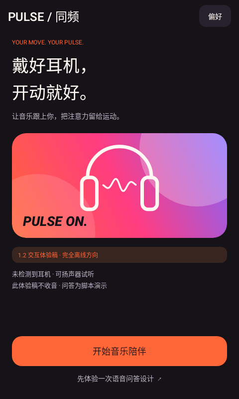
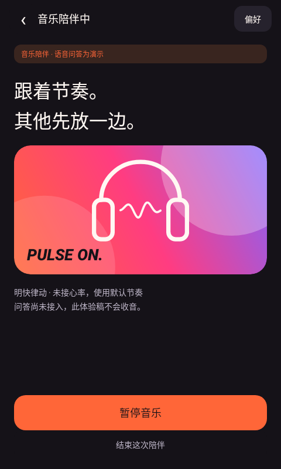
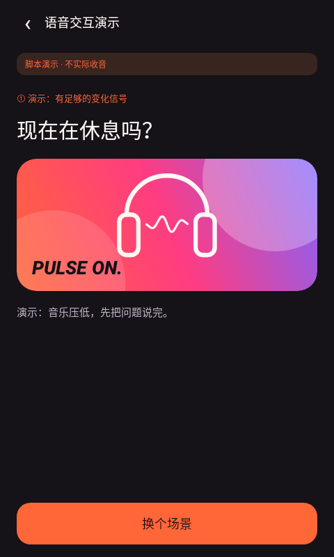

# PULSE 1.2 界面预览

来自实际 Android View 代码的框架/Skia渲染，**不是整机模拟器或手机截图**。音频状态使用明确标注的测试样本，不证明音频已实测。语音画面为脚本演示，不实际录音、识别或推测运动。

| 首页 | 陪伴中 | 询问脚本 |
| --- | --- | --- |
|  |  |  |

- [首页](01-home.png)
- [陪伴中](02-live.png)
- [暂停](03-paused.png)
- [音乐偏好](04-music.png)
- [偏好](05-preferences.png)
- [可选设备](06-devices.png)
- [结束](07-goodbye.png)
- [询问脚本](08-question.png)
- [回复窗口脚本](09-reply-window.png)
- [已确认脚本](10-confirmed-demo.png)
- [演示场景](11-demo-cases.png)
- [沉默脚本](12-silence.png)
- [离线语音设计](13-voice-design.png)
- [隐私与边界](14-privacy.png)
